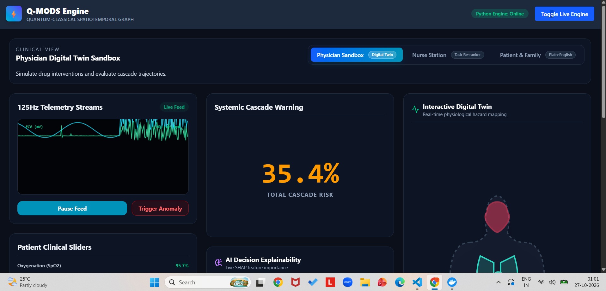
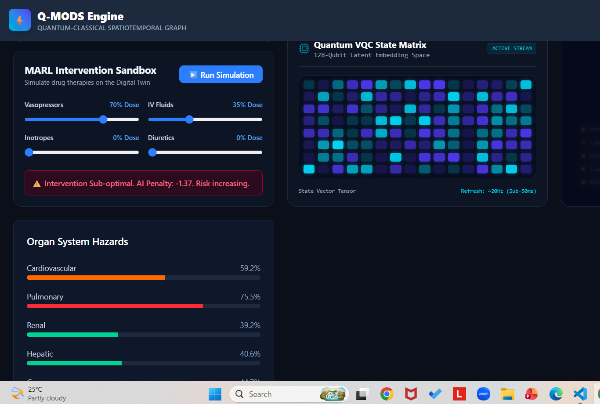
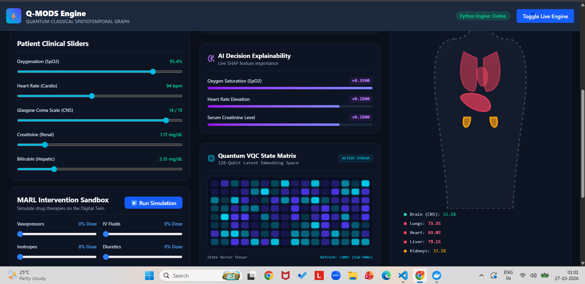
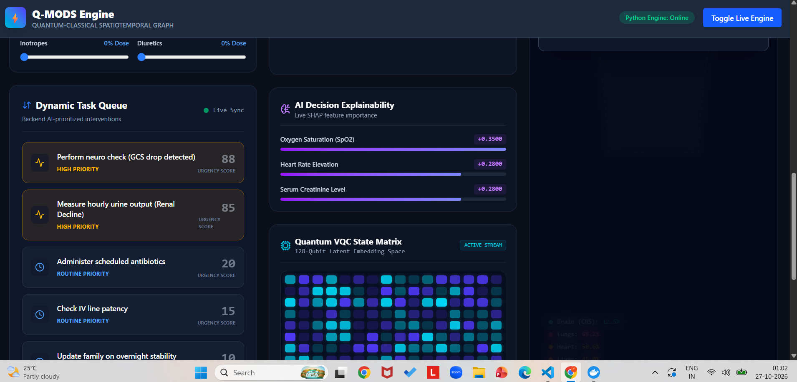
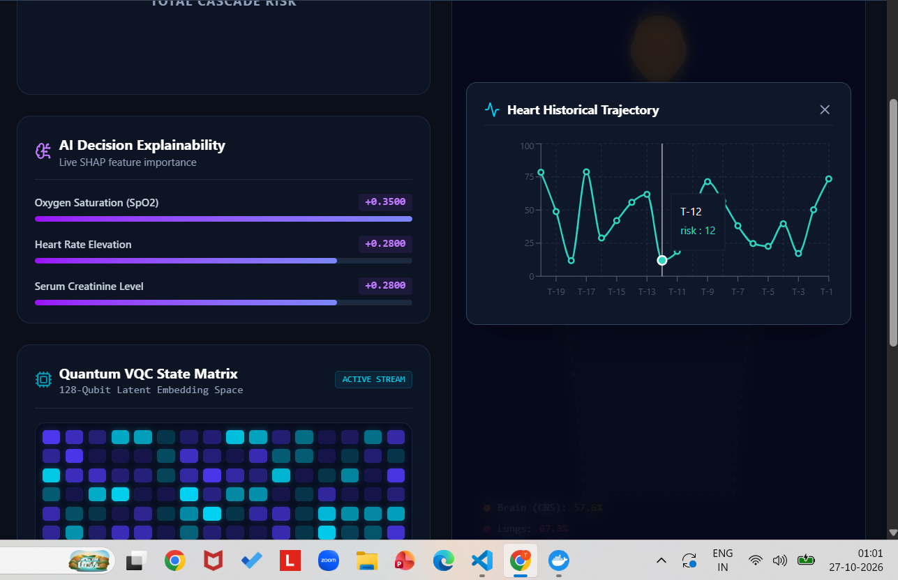
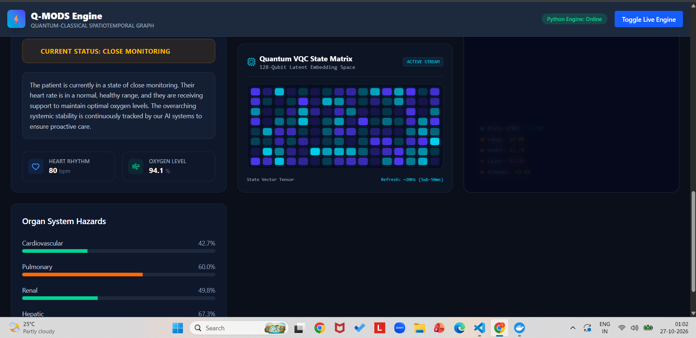
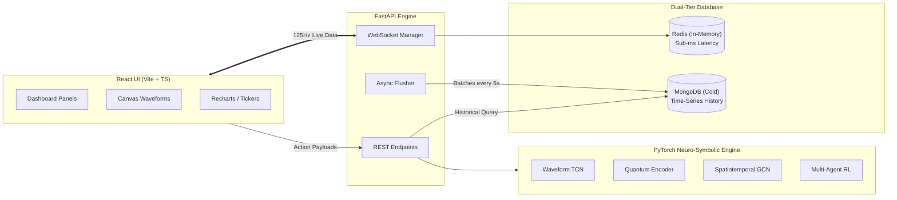

# Q-MODS Engine

### Hybrid Quantum-Classical Spatiotemporal Graph for ICU Cascade Prediction

[](https://www.python.org/)
[](https://fastapi.tiangolo.com/)
[](https://pytorch.org/)
[](https://react.dev/)
[](https://redis.io/)
[](https://mongodb.com/)

ICU telemetry today is highly reactive. Alarms sound only *after* a patient's vitals cross a critical threshold. By the time Multi-Organ Dysfunction Syndrome (MODS) is clinically apparent, systemic cascade failure has already begun.

**Q-MODS Engine is a real-time predictive Digital Twin for the ICU.**
- It ingests 125Hz high-frequency telemetry and compresses it using a Quantum Variational Circuit (VQC).
- It maps the human body as a Spatiotemporal Graph, using Graph Convolutional Networks (STGCN) to predict how failure in one organ (e.g., Renal) will probabilistically cascade to others (e.g., Pulmonary).
- It features a **MARL Intervention Sandbox** allowing physicians to simulate the physiological reaction of vasopressors, inotropes, and IV fluids *before* injecting them into the patient.

## Screenshots

### 1. Interactive Digital Twin
Systemic cascade warning and glowing organ hazard mapping. High-frequency telemetry streams render live alongside overall cascade probability.



---

### 2. MARL Intervention Sandbox
Simulate pharmacological therapies (Vasopressors, IV Fluids, Inotropes, Diuretics). The AI instantly evaluates the intervention, returns a penalty or recovery score, and adjusts the patient's predicted trajectory and organ hazard levels.



---

### 3. Historical Trajectory (Cold Storage)
Live animated trendlines pulling from MongoDB. Visualizes the exact temporal deterioration or recovery of specific organs (e.g., Heart, Brain).



---

### 4. Dynamic Nurse Task Queue
Backend AI-prioritized interventions. Translates live risk spikes (e.g., GCS drops, Renal decline) into immediate, scored tasks for the nursing staff.



---

### 5. Quantum VQC & SHAP Explainer
Complete AI transparency. Live matrix visualization of the latent embedding space, accompanied by SHAP feature importance for clinical trust. Patient clinical sliders let clinicians adjust inputs (SpO2, heart rate, GCS, creatinine, bilirubin) and watch the per-organ hazard scores respond.



---

### 6. Patient & Family Status Hub
Predictive telemetry translated into a plain-English status summary, with heart rhythm, oxygen level, and a per-organ hazard breakdown.



*(Platform is responsive and optimized for low-latency browser rendering).*

---

## The Clinical Workspaces

The platform adapts dynamically based on the clinical role accessing the system.

| Role | Interface | Capabilities & Outcomes |
|---|---|---|
| **Physician** | Digital Twin Sandbox | View 125Hz telemetry, monitor spatiotemporal organ hazard levels, and use the MARL Sandbox to test drug combinations (Vasopressors/Fluids) against the PyTorch prediction engine. |
| **Nurse** | Dynamic Task Re-ranker | Replaces static shift checklists with a live, AI-scored queue. Triggers immediate tasks based on subtle rate-of-change trajectory shifts (e.g., "Acute HR Spike - Check for arrhythmia"). |
| **Patient & Family** | Status Hub | Translates complex predictive telemetry into a simple, plain-English traffic light stability board updated automatically. |

---

## Architecture & Data Workflow

Q-MODS Engine bridges an ultra-low-latency high-frequency trading (HFT) data pattern with deep learning inference.



### The 5-Step Execution Workflow

1. **Ingestion & Buffering (Redis):** The Python engine generates or ingests raw ECG, ABP, and RESP waveforms alongside labs. To prevent database locking during high-frequency updates, live data is immediately buffered into Redis.
2. **Quantum-Classical Encoding:** The `WaveformTCNCompressor` extracts features from the time-series arrays. These features are mapped against lab results in an 8-qubit `QuantumVQCEncoder` to create a dense 128-dimensional patient state vector.
3. **Spatiotemporal Graph Prediction:** The `PhysiologyGraphBuilder` maps the state vector to a 5-node graph (Heart, Lungs, Brain, Liver, Kidneys). The `STGCN` model calculates both the system-wide cascade alert probability and the localized hazard score for each specific organ.
4. **Intervention Sandbox (MARL):** When a physician alters the drug sliders in the UI, a POST request hits `/api/marl/step`. The `QMODSMultiAgentEnv` simulates the adversarial interaction between the disease progression (Patho-Agent) and the drug therapy (Therapy-Agent), returning a calculated recovery or penalty score.
5. **The Temporal Bridge (MongoDB):** A background async flusher wakes up every 5 seconds, pulls the latest snapshot from Redis, and commits it to MongoDB. The React `HistoryModal` actively polls this MongoDB endpoint, creating an animated, scrolling ICU ticker.

---

## Tech Stack

* **Frontend:** React 19, TypeScript, Vite, Tailwind CSS, Recharts (for live polling modals), HTML5 Canvas (for 125Hz waveform rendering).
* **Backend:** Python 3.11+, FastAPI, Uvicorn, WebSockets.
* **Machine Learning & Quantum:** PyTorch, PyTorch Geometric (for STGCN), custom MARL environments, **Quantum Variational Circuits (VQC)**, SHAP (for GNN explainability).
* **Data Layer:** Redis (asyncio for HFT streaming), MongoDB (Motor/PyMongo for permanent historical snapshots).

---

## Quick Start (Local Deployment)

Ensure you have Python 3.11+, Node.js, and local instances of Redis and MongoDB running.

**1. Boot the FastAPI Backend:**
```powershell
git clone https://github.com/tanishkagoswami/Q-MODS-Engine.git
cd Q-MODS-Engine/backend
python -m venv venv
.\venv\Scripts\activate
pip install -r requirements.txt
uvicorn api.main:app --reload
```

**2. Boot the React Frontend:**
In a separate terminal window:
```powershell
cd Q-MODS-Engine/frontend
npm install
npm run dev
```
Navigate to `http://localhost:5173`. Toggle the "Live Engine" button in the top right header to initiate the WebSocket telemetry stream.

---

## Author

**Tanishka**